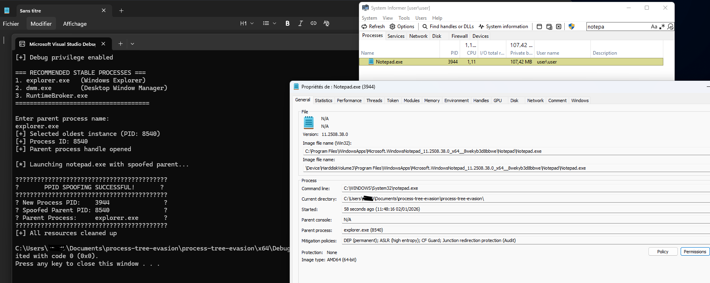
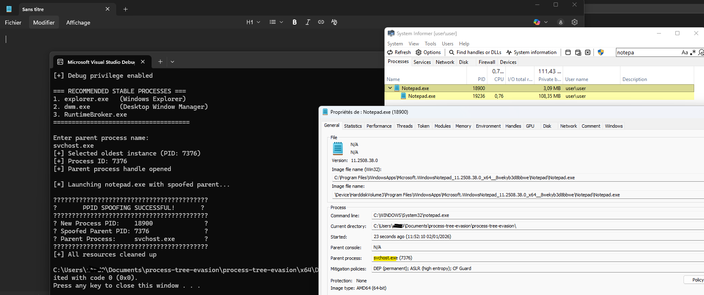

# Process tree evasion lab

Small Windows proof of concept for studying parent process ID (PPID)
spoofing and the resulting process-tree telemetry.

The program starts `notepad.exe` with a user-selected process set as its parent
through `PROC_THREAD_ATTRIBUTE_PARENT_PROCESS`. I wrote it to better understand
Windows process creation, token privileges, and what endpoint monitoring tools
can observe when the parent shown in a process tree is not the process that
actually initiated the operation.

This is a learning project, not an EDR bypass. Modern endpoint products can use
telemetry beyond the reported parent PID, and the technique may generate alerts.

## What it does

1. Requests `SeDebugPrivilege` for the current process token.
2. Finds the oldest accessible instance of a process selected by name.
3. Opens that process with the rights required to use it as a parent.
4. Creates a `STARTUPINFOEX` attribute list containing the selected parent.
5. Starts `%WINDIR%\System32\notepad.exe` with
   `EXTENDED_STARTUPINFO_PRESENT`.
6. Reports the new PID and releases the allocated memory and handles.

The payload is intentionally fixed to Notepad. The repository does not include
shellcode, a beacon, persistence, or a mechanism for injecting code into the
new process.

## Repository layout

```text
.
├── images/     Screenshots from local lab runs
├── docs/       Manual Windows validation checklist
├── CMakeLists.txt  Windows build definition
├── main.cpp    Process creation and attribute-list setup
├── proc.cpp    Privilege, process lookup, and handle helpers
└── proc.h      Helper declarations
```

## Requirements

- Windows 10 or 11
- A C++ compiler and Windows SDK, such as Visual Studio with the Desktop
  development with C++ workload
- An elevated terminal for targets that require `SeDebugPrivilege`

The project uses the Windows API and links against `Advapi32.lib` for the token
privilege functions. The CMake target configures this dependency automatically.

## Building

From a Visual Studio Developer PowerShell or Developer Command Prompt, with
CMake 3.20 or newer installed:

```powershell
cmake -S . -B build -A x64
cmake --build build --config Debug
.\build\Debug\process_tree_evasion.exe
```

These commands use the default Visual Studio generator. If a different generator
is selected on your machine, its architecture options and output paths may differ.

Alternatively, compile directly from an **x64 Native Tools Command Prompt for VS**:

```bat
mkdir build
cl /nologo /std:c++17 /W4 /EHsc /utf-8 /DUNICODE /D_UNICODE main.cpp proc.cpp /Fobuild\ /Febuild\process_tree_evasion.exe /link Advapi32.lib
```

Build instructions were added during repository cleanup. They still need a native
Windows build and runtime check; see [the validation checklist](docs/VALIDATION.md).

## Running the lab

Run the compiled program from an elevated terminal, then enter the executable
name of a running process when prompted. The program launches Notepad and prints
the selected parent PID and the PID of the newly created process.

Use a disposable Windows test environment with endpoint telemetry enabled. A
process viewer alone shows only part of the story; the useful exercise is to
compare the displayed process tree with the events and alerts recorded by the
monitoring stack.

Example screenshots from local runs are available in [`images/`](./images/).

### Example: `explorer.exe` as the reported parent



### Example: `svchost.exe` as the reported parent



## Implementation notes

The proof of concept uses the documented extended process creation API:

- `OpenProcessToken` and `AdjustTokenPrivileges`
- `CreateToolhelp32Snapshot` and `Process32FirstW` / `Process32NextW`
- `InitializeProcThreadAttributeList`
- `UpdateProcThreadAttribute`
- `CreateProcessA`

Enabling `SeDebugPrivilege` is not privilege escalation. It only enables a
privilege already present in the current token, which is why an elevated process
is normally required for this lab.

`AdjustTokenPrivileges` can return success while setting `GetLastError()` to
`ERROR_NOT_ALL_ASSIGNED`. The helper checks both results. The lab currently stops
if the privilege cannot be enabled, even though selecting some parents does not
require it. Elevation also does not guarantee access to protected processes.

The oldest process is selected among instances whose creation time can be queried.
Opening that instance with the parent-creation rights can still fail; the program
does not try another instance automatically. A process may also exit between
enumeration and creation.

The executable path is passed explicitly as `lpApplicationName` to `CreateProcessA`.
The example retains the ANSI APIs for simplicity and does not fully support
non-ASCII input or paths. Selecting a parent through this documented API does not
inject code into that process. Successful creation alone does not verify how a
particular monitoring product will display or detect the operation.

## Limitations

- The child executable is fixed to `notepad.exe`.
- Only process names can be entered; when several instances exist, the oldest
  accessible process is selected.
- Cross-architecture behavior has not been validated.
- A CMake build definition is included; native Windows validation is pending.
- There are no automated tests. Manual checks are described in `docs/VALIDATION.md`.
- Detection results depend on the Windows version and monitoring product.
- The code demonstrates parent selection; it does not demonstrate that an EDR
  has been bypassed.

## API references

- [Process creation attributes](https://learn.microsoft.com/en-us/windows/win32/api/processthreadsapi/nf-processthreadsapi-updateprocthreadattribute)
- [CreateProcessA](https://learn.microsoft.com/en-us/windows/win32/api/processthreadsapi/nf-processthreadsapi-createprocessa)
- [AdjustTokenPrivileges](https://learn.microsoft.com/en-us/windows/win32/api/securitybaseapi/nf-securitybaseapi-adjusttokenprivileges)

## Responsible use

This repository is intended for Windows internals study, defensive research,
and authorized security testing. Use it only on systems you own or are explicitly
permitted to assess.
